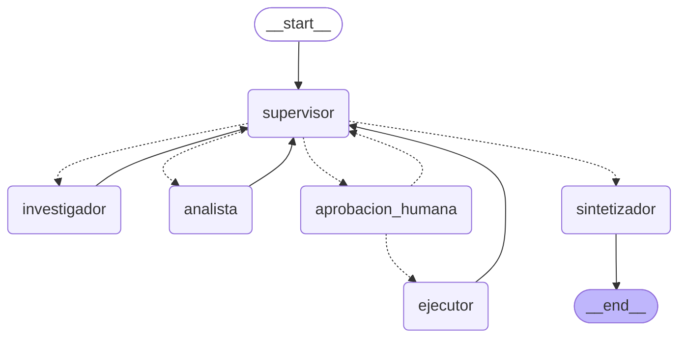

# Pre-entrega 7: API de producción y monitoreo activo

API REST con **FastAPI** que expone el orquestador multi-agente de *Supermercados del Valle* (Entrega 6), con:

- **Endpoints asíncronos:** `POST /tasks` encola la tarea y devuelve un `job_id` al instante. El grafo corre en segundo plano.
- **Redis:** guarda el estado de cada job (`PENDING`, `RUNNING`, `WAITING_APPROVAL`, `DONE` y `FAILED`), la cola de tareas y los **checkpoints de LangGraph** (`RedisSaver`).
- **Observabilidad con LangSmith:** cada ejecución es una traza con todos sus nodos, las llamadas al LLM, los tokens y el costo.
- **Human-in-the-loop:** antes de **cambiar un precio** (una herramienta con efectos reales), el grafo se pausa hasta que un humano lo apruebe con `POST /tasks/{id}/approve`.

## Cómo funciona

```
cliente ──POST /tasks──▶ FastAPI ──RPUSH──▶ Redis (cola:tareas)        ◀── job:{id} (estado)
   ▲                        │                     │
   │                   202 + job_id           BLPOP │
   │                                               ▼
   └──GET /tasks/{id}── (polling)          worker (asyncio) ──to_thread──▶ grafo LangGraph
                                                                            │   ▲
                                                           checkpoints ─────┘   │ trazas
                                                           (RedisSaver)     LangSmith
```

1. `POST /tasks` crea el hash `job:{id}` en estado `PENDING`, pone un mensaje en la lista `cola:tareas` y responde **202** con el `job_id`. No espera al grafo.
2. Hay 5 **workers** (tareas `asyncio` que arrancan con la API) esperando en la cola con `BLPOP`. El que toma el mensaje pasa el job a `RUNNING` y corre el grafo en un hilo (`asyncio.to_thread`), así el event loop de FastAPI nunca se bloquea.
3. Cuando el grafo termina, el job pasa a `DONE` con el resultado. Si el grafo lanza una excepción, pasa a **`FAILED`** con el error, así el cliente no queda esperando para siempre.
4. Si el grafo llega a una acción crítica, se **pausa**: el job pasa a `WAITING_APPROVAL` con la acción pendiente. El estado del grafo queda guardado en Redis por el `RedisSaver`.
5. `POST /tasks/{id}/approve` encola un mensaje "reanudar". Un worker retoma el grafo desde el checkpoint con `Command(resume=...)`.

### Estados de un job

```
PENDING ─▶ RUNNING ─┬─▶ DONE
                    ├─▶ FAILED                (excepción en el grafo)
                    └─▶ WAITING_APPROVAL ─(approve)─▶ PENDING ─▶ RUNNING ─▶ ...
```

## El grafo



Es el orquestador de la Entrega 6 (Supervisor, Investigador, Analista y Sintetizador) con dos nodos nuevos:

- **`aprobacion_humana`** ([app/hitl.py](app/hitl.py)): llama a `interrupt()` y pausa el grafo. Al reanudar, según la respuesta va al `ejecutor` (aprobado) o vuelve al `supervisor` con un aporte que dice que el cambio fue rechazado.
- **`ejecutor`** ([app/agents/executor_agent.py](app/agents/executor_agent.py)): ejecuta la herramienta `actualizar_precio`, que **escribe en Redis** el precio vigente (`precios:supermercados_del_valle`) y deja un registro en `auditoria:precios`.

### Qué tarea es "crítica"

Cambiar un precio es la única acción con **efectos secundarios reales**. Por eso:

- El Supervisor solo elige `ejecutor` si el usuario **pidió explícitamente** cambiar un precio y el Analista ya hizo la comparación. En ese caso completa `cambio_precio` (producto, precio nuevo y motivo) en su salida estructurada.
- La arista condicional `elegir_siguiente` **nunca** va directo al `ejecutor`: lo manda siempre a `aprobacion_humana`. Así no hay forma de cambiar un precio sin la aprobación de una persona.
- Las preguntas que solo piden información o análisis terminan sin pausa.

## Estructura

| Archivo | Qué hace |
|---|---|
| [app/main.py](app/main.py) | FastAPI: `POST /tasks`, `GET /tasks/{id}` y `GET /health`. Arranca Redis, el grafo y los workers en el `lifespan`. |
| [app/worker.py](app/worker.py) | Workers que sacan tareas de la cola, corren el grafo y actualizan el estado. Captura las excepciones y deja el job en `FAILED`. |
| [app/jobs.py](app/jobs.py) | Estado de los jobs y cola en Redis, con el cliente asíncrono `redis.asyncio`. |
| [app/graph.py](app/graph.py) | Arma el `StateGraph` y lo compila con el `RedisSaver`. |
| [app/hitl.py](app/hitl.py) | Nodo `aprobacion_humana` (`interrupt`) y endpoint `POST /tasks/{id}/approve`. |
| [app/observability.py](app/observability.py) | Configuración de LangSmith y decorador `traceable`. |
| [app/supervisor.py](app/supervisor.py) | Supervisor (ruteo + rúbrica) y Sintetizador. |
| [app/agents/](app/agents/) | Investigador, Analista y Ejecutor. |
| [app/state.py](app/state.py) | Estado compartido del grafo. |
| [app/config.py](app/config.py) | LLM, Redis, validación del `.env` y logs con tiempos por nodo. |
| [scripts/prueba_carga.py](scripts/prueba_carga.py) | Envía 5 tareas concurrentes y muestra la latencia de cada una. |
| [scripts/demo_hitl.py](scripts/demo_hitl.py) | Demo de una tarea crítica que espera aprobación. |
| [tests/](tests/) | Tests con pytest (sin API key ni Redis reales). |
| [docker-compose.yml](docker-compose.yml) | Redis 8 y la API. |
| [screenshots/](screenshots/) | Capturas del dashboard de LangSmith. |

## Cómo levantarlo

Requisitos: **Python 3.12+** y **Docker Desktop** (para Redis).

### 1. Instalar dependencias

**Windows (PowerShell):**

```powershell
python -m venv .venv
.venv\Scripts\activate
pip install -r requirements.txt
copy .env.example .env
```

**Linux / macOS:**

```bash
python3 -m venv .venv
source .venv/bin/activate
pip install -r requirements.txt
cp .env.example .env
```

### 2. Configurar el `.env`

| Variable | Para qué |
|---|---|
| `ANTHROPIC_API_KEY` | Clave de Claude (obligatoria). |
| `REDIS_URL` | Por defecto `redis://localhost:6379`. |
| `LANGSMITH_TRACING` | `true` para enviar trazas. |
| `LANGSMITH_API_KEY` | Clave de [smith.langchain.com](https://smith.langchain.com) (Settings → API Keys). Es obligatoria si `LANGSMITH_TRACING=true`. |
| `LANGSMITH_PROJECT` | Proyecto donde aparecen las trazas (`supermercados-del-valle-e7`). |
| `WORKERS` | Cuántas tareas se procesan a la vez (por defecto 5). |

Si falta una variable obligatoria, la API corta al inicio con un mensaje que dice cuál falta.

### 3. Levantar Redis

El `RedisSaver` de LangGraph necesita **Redis 8** con los módulos `search` y `ReJSON`.

**Opción A: Docker** (Docker Desktop abierto, el mismo comando en todos los sistemas):

```bash
docker compose up -d redis
docker compose exec redis redis-cli ping
```

Tiene que responder `PONG`. La imagen `redis:8.2` ya trae los módulos.

**Opción B: sin Docker** (Linux, o Windows con WSL2 si tu versión de Windows no soporta Docker Desktop):

En Windows, primero instalá Ubuntu desde PowerShell como administrador con `wsl --install -d Ubuntu`, y corré lo que sigue adentro de Ubuntu. Hay que usar el **repositorio oficial de Redis**: el paquete de Ubuntu trae Redis 8 sin los módulos `search` y `ReJSON`.

```bash
sudo apt-get update && sudo apt-get install -y lsb-release curl gpg
curl -fsSL https://packages.redis.io/gpg | sudo gpg --dearmor -o /usr/share/keyrings/redis-archive-keyring.gpg
sudo chmod 644 /usr/share/keyrings/redis-archive-keyring.gpg
echo "deb [signed-by=/usr/share/keyrings/redis-archive-keyring.gpg] https://packages.redis.io/deb $(lsb_release -cs) main" | sudo tee /etc/apt/sources.list.d/redis.list
sudo apt-get update && sudo apt-get install -y redis redis-server redis-tools
sudo systemctl enable --now redis-server
redis-cli MODULE LIST | grep -A1 name
```

En la lista tienen que aparecer `search` y `ReJSON`. WSL2 comparte `localhost` con Windows, así que la API corriendo en Windows se conecta con `REDIS_URL=redis://localhost:6379`. Si reiniciás la PC, abrí Ubuntu una vez para que Redis vuelva a arrancar.

En los comandos de las secciones siguientes, si usás la opción B, reemplazá `docker compose exec redis redis-cli` por `wsl redis-cli`.

### 4. Levantar la API

Con el entorno virtual activado:

```bash
uvicorn app.main:app --port 8000
```

Al arrancar, el log muestra si LangSmith está activo y cuántos workers hay. Si Redis no está levantado, la API corta con un mensaje claro. La documentación interactiva queda en <http://localhost:8000/docs>.

**Alternativa, todo con Docker:** `docker compose up --build` levanta Redis y la API juntos.

**Alternativa, workers en otro proceso:** poné `WORKERS=0` en el `.env`, levantá la API con `uvicorn` y en otra terminal corré `python -m app.worker`.

## Cómo probarlo

### Una tarea

**Linux / macOS (bash):**

```bash
curl -X POST localhost:8000/tasks -H "Content-Type: application/json" \
     -d '{"pregunta": "¿Cómo está el precio de la leche frente a la competencia?"}'
# {"job_id":"3f2c...","estado":"PENDING"}

curl localhost:8000/tasks/3f2c...
```

**Windows (PowerShell):**

```powershell
$job = Invoke-RestMethod -Method Post -Uri http://localhost:8000/tasks -ContentType "application/json" `
       -Body '{"pregunta": "¿Cómo está el precio de la leche frente a la competencia?"}'
Invoke-RestMethod http://localhost:8000/tasks/$($job.job_id)
```

### Human-in-the-loop

```bash
python scripts/demo_hitl.py            # te pregunta por consola si aprobás
python scripts/demo_hitl.py --aprobar
python scripts/demo_hitl.py --rechazar
```

El script pide *"Analizá cómo está nuestra yerba frente a la competencia y, si estamos más caros que el promedio, bajá el precio para quedar en el promedio."*. El job queda en `WAITING_APPROVAL` con la acción pendiente:

```json
{
  "accion": "actualizar_precio",
  "producto": "yerba",
  "nuevo_precio": 4133.33,
  "motivo": "Nuestro precio actual es $4200 y el promedio de la competencia ... es $4133,33 ...",
  "pregunta": "¿Aprobás aplicar este cambio de precio?"
}
```

Para aprobarlo a mano: `POST /tasks/{id}/approve` con `{"aprobado": true, "comentario": "ok"}`. Si el job no está esperando aprobación, responde **409**. Para ver el cambio aplicado en Redis:

```bash
docker compose exec redis redis-cli HGETALL precios:supermercados_del_valle
docker compose exec redis redis-cli LRANGE auditoria:precios 0 -1
```

### Prueba de carga: 5 peticiones concurrentes

```bash
python scripts/prueba_carga.py
```

Envía 5 preguntas distintas **al mismo tiempo** (`asyncio.gather`), hace polling hasta que todas terminan y muestra la latencia que vio el cliente:

```
Enviando 5 tareas concurrentes a http://localhost:8000 ...

0b23dc34  DONE                32.9 s  investigador -> analista
aaea6f49  DONE                26.4 s  investigador -> analista
83b267fc  DONE                24.4 s  investigador -> analista
0007c10a  DONE                16.4 s  investigador
70bfc452  DONE                28.5 s  investigador -> analista

Tiempo total: 32.9 s (si fuera secuencial sería ~129 s)
Latencia vista por el cliente: p50 = 26.4 s · p95 = 32.0 s
```

Las 5 tareas corren en paralelo: el tiempo total es el de la más lenta, no la suma. El p95 del script es una referencia del lado del cliente. Las métricas que se entregan son las del dashboard (siguiente sección).

## Observabilidad con LangSmith

Con `LANGSMITH_TRACING=true`, LangSmith registra solo cada nodo del grafo, cada llamada a Claude (con los tokens de entrada y salida) y cada herramienta. Además, en [app/worker.py](app/worker.py) la ejecución de cada job está decorada con `@traceable(name="tarea_orquestador")` y lleva el `job_id` en la metadata. Así **cada ejecución es una traza** y se puede buscar por `job_id`.

> Un job con aprobación humana genera **dos trazas**: una hasta la pausa y otra desde la reanudación.

### Cómo leer las métricas de la corrida

1. **Trazas:** en el proyecto `supermercados-del-valle-e7` aparecen las 5 trazas `tarea_orquestador`. Al abrir una se ve el árbol de nodos (`supervisor`, `investigador`, `analista`, `sintetizador`) con la latencia y los tokens de cada uno.
2. **Costo por ejecución:** la columna *Cost* de la tabla de trazas. LangSmith la calcula sola con los tokens de entrada y salida y su tabla de precios de modelos. Si para `claude-sonnet-5-5` aparece vacía, agregá el precio del modelo en *Settings → Model Pricing* (patrón `claude-sonnet-5-5`, con los precios por token de la página de precios de Anthropic).
3. **Latencia p95:** en *Monitoring* (o en un dashboard propio con *Add chart*), elegí la métrica de latencia de las trazas con el percentil **p95**, filtrado a la ventana de tiempo de la corrida.
4. **Dónde se concentra la latencia y los tokens:** al abrir una traza y comparar los nodos, los que más pesan son los agentes ReAct (`investigador` y `analista`), porque hacen varias llamadas al LLM (pensar → herramienta → responder). El `supervisor` se llama varias veces por tarea, pero cada llamada es corta. El `ejecutor` no usa el LLM.

### Capturas

En [screenshots/](screenshots/):

| Archivo | Qué muestra |
|---|---|
| `01_trazas.png` | Lista de trazas de las 5 peticiones concurrentes. |
| `02_traza_detalle.png` | Árbol de nodos de una traza, con la latencia y los tokens de cada nodo. |
| `03_costo_por_ejecucion.png` | Costo de cada una de las 5 ejecuciones. |
| `04_latencia_p95.png` | Latencia p95 de la corrida. |
| `05_hitl.png` | Traza de un job pausado en `aprobacion_humana` y su reanudación. |

## Errores comunes que se evitan

- **No bloquear el event loop:** los endpoints son `async` y usan el cliente asíncrono `redis.asyncio`. El grafo, que es sincrónico, corre en un hilo con `asyncio.to_thread`. El `setup()` del `RedisSaver` también corre en un hilo.
- **Excepciones en segundo plano:** `procesar()` en [app/worker.py](app/worker.py) envuelve la ejecución en `try/except`. Ante cualquier error, el job queda en `FAILED` con el mensaje en el campo `error`. Si llega un mensaje roto a la cola, se registra en el log y el worker sigue andando.
- **Nodo HITL sin efectos antes del `interrupt()`:** al reanudar, LangGraph vuelve a correr el nodo desde el principio. Por eso `aprobacion_humana` no llama al LLM ni escribe nada antes de pausar.

## Logs

Cada nodo registra cuánto tardó, y cada job su estado final. Ejemplo real del job de la demo HITL, rechazado:

```
18:41:11 [INFO] nodo supervisor -> investigador (3.56 s)
18:41:20 [INFO] nodo investigador (9.38 s)
18:41:25 [INFO] nodo supervisor -> analista (5.15 s)
18:41:35 [INFO] nodo analista (9.07 s)
18:41:40 [INFO] nodo supervisor -> ejecutor (5.79 s)
18:41:40 [INFO] job 341a1e54b6f642869b563e881d6e8984 WAITING_APPROVAL (32.96 s)
18:41:42 [INFO] aprobación humana: RECHAZADO {'producto': 'yerba', 'nuevo_precio': 4133.33, ...}
18:41:44 [INFO] nodo supervisor -> FINISH (2.28 s)
18:41:48 [INFO] nodo sintetizador (3.89 s)
18:41:48 [INFO] job 341a1e54b6f642869b563e881d6e8984 DONE (6.18 s)
```

## Tests

```bash
pytest
```

Son 26 tests que **no llaman a la API de Anthropic ni necesitan Redis**: usan `fakeredis` (un Redis en memoria) y el `InMemorySaver` de LangGraph. Cubren:

- **API:** `POST /tasks` devuelve 202 y encola, validación de la pregunta (422), 404 de un job inexistente y 409 si se aprueba un job que no espera aprobación.
- **Worker:** un grafo que lanza una excepción deja el job en `FAILED`. También el flujo completo: `WAITING_APPROVAL` → aprobación → `DONE`, con el precio escrito en Redis.
- **HITL:** el grafo se pausa antes del ejecutor; si se aprueba aplica el cambio y si se rechaza no toca nada.
- **Supervisor:** el ruteo (el `ejecutor` siempre pasa por `aprobacion_humana`), el corte por `MAX_PASOS` y el pedido de `ejecutor` sin cambio concreto.
- **Herramientas y `data/`:** búsqueda, sentimiento, comparación de precios, y archivo faltante, inválido o vacío.
- **Entorno:** mensaje claro si falta `ANTHROPIC_API_KEY`, o `LANGSMITH_API_KEY` con el tracing activo.

## Notas sobre el modelo

- Todos los agentes usan el mismo LLM, que se crea en `get_llm()` de [app/config.py](app/config.py).
- La salida estructurada del supervisor usa `method="json_schema"`, que es el método que soporta este modelo.
- `create_react_agent` muestra un aviso de deprecación (en LangGraph 1.x se movió a `langchain.agents.create_agent`). Se mantiene del orquestador de la Entrega 6 y funciona igual.
